# mcp-feature-test

[](https://github.com/linuxrrze/mcp-feature-test/actions/workflows/docker-image.yml)

An MCP server for checking which **user-interaction features** an MCP client (Claude Desktop, Claude Code, VS Code, Cursor, Open WebUI, the MCP Inspector, or your own client) actually supports:

- **Elicitation, form mode**: the client shows a native dialog built from a JSON schema.
- **Elicitation, URL mode**: the client opens a web page in the browser (the pattern for OAuth or secret entry).
- **Multi-step elicitation**: a three-dialog wizard that carries signed `requestState` between rounds.

  How both elicitation modes flow between user, client, browser and server, on both protocol generations, is drawn step by step in [docs/elicitation.md](docs/elicitation.md).
- **MCP Apps**: an interactive HTML UI (`ui://` resource) that the host renders in a sandboxed iframe.
- **Progress, logging and cancellation** for long-running tools.
- **Files**: returning files in tool results (embedded resources, `resource_link`, image, audio), uploading from an MCP App, app downloads, form fields the spec doesn't have, and the experimental `x-mcp-file` draft.
- **Capability inspection**: the server logs what each client declares and can report it back (`inspect_client`, `list_seen_clients`).

The server speaks both protocol generations, **2026-07-28** (stateless, `input_required`) and **2025-era** (`initialize` handshake, server→client `elicitation/create`), over **stdio** and **Streamable HTTP**. It is built on the MCP TypeScript SDK v2 (`@modelcontextprotocol/server` 2.4) and `@modelcontextprotocol/ext-apps` 2.0.

| MCP App (Dialog Lab), light | MCP App (Dialog Lab), dark |
| --- | --- |
| 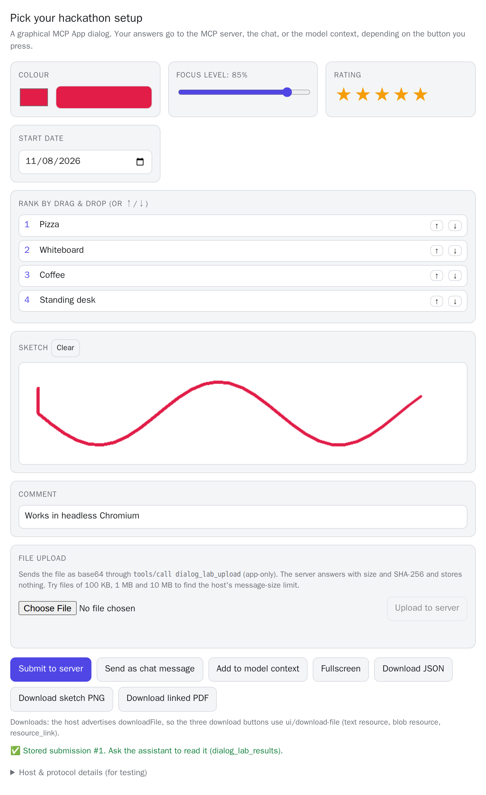 | 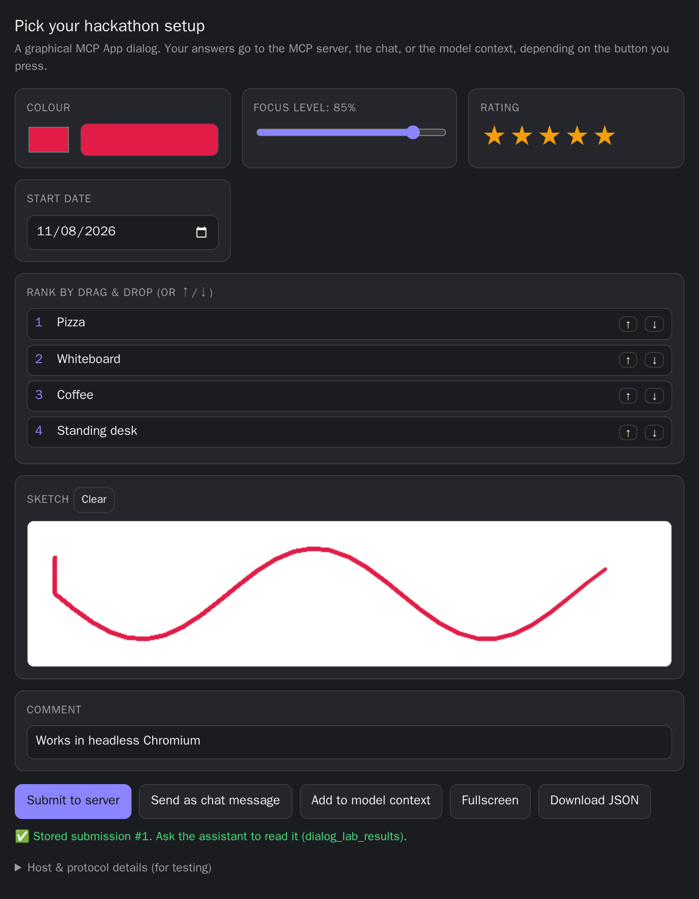 |

| Colour picker (`pick_color`), Wheel, dark | Values, light | Palettes, dark |
| --- | --- | --- |
| 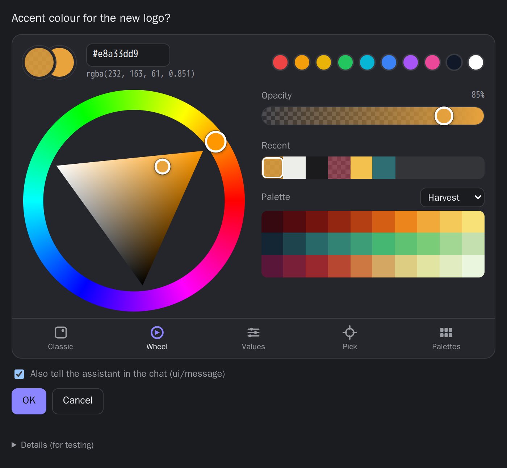 | 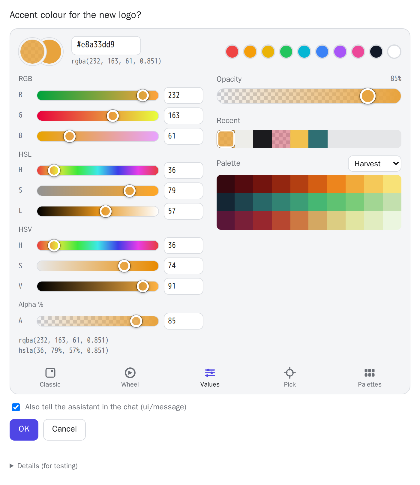 | 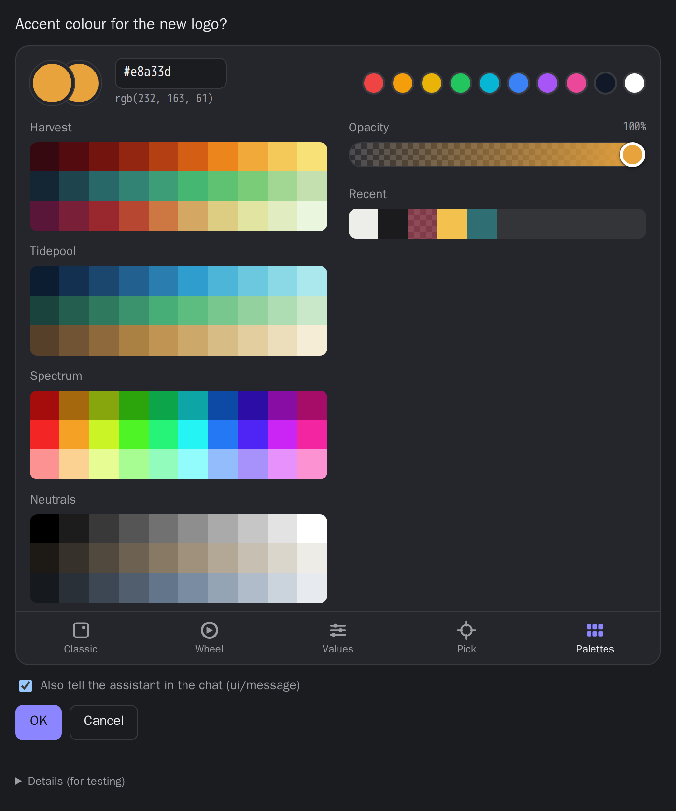 |

These screenshots come from the automated browser test (`npm run screenshots`). They show the apps inside a minimal test host, not inside a particular MCP client. Each client draws its own frame around the iframe. The colour picker also fits narrow hosts ([360 px](docs/images/color-picker-wheel-light-narrow.png)).

## Contents

- [Tools and the features they test](#tools-and-the-features-they-test)
- [Quick start](#quick-start)
- [Running](#running)
- [Environment variables](#environment-variables)
- [Connecting clients](#connecting-clients)
- [What you should see](#what-you-should-see)
- [Capability logging](#capability-logging)
- [Troubleshooting](#troubleshooting)
- [Client support](#client-support)
- [Development and tests](#development-and-tests)
- More documentation: [elicitation: form vs. URL mode (diagrams)](docs/elicitation.md) · [MCP server vs. MCP App](docs/server-vs-app.md) · [architecture](docs/architecture.md) · [testing](docs/testing.md) · [Docker](docs/docker.md) · [Open WebUI](docs/openwebui.md)

## Tools and the features they test

| Tool | MCP feature exercised | Spec version that introduced it |
| --- | --- | --- |
| `inspect_client` | Reports the protocol version, client info and declared capabilities (elicitation form/url, MCP Apps UI, sampling, roots, tasks, extensions) | n/a (reads `initialize` or the per-request `_meta` envelope) |
| `list_seen_clients` | Every distinct client this server process has seen, with capability flags and request counts | n/a |
| `elicit_confirm` | Form elicitation: a yes/no confirmation dialog; accept, decline and cancel are each reported | Form elicitation: 2025-06-18 |
| `elicit_all_field_types` | Form elicitation with every allowed field type: string with min/max length, `email`/`uri`/`date`/`date-time` formats, integer, number, boolean, untitled and titled single-select, legacy `enumNames`, multi-select (untitled and titled), and defaults. `variant`: `all`, `basic`, `formats` or `enums` | Base types: 2025-06-18. Titled/multi-select enums and defaults on all types: 2025-11-25 |
| `elicit_parallel` | Two independent elicitations in a single round | Multiple `inputRequests`: 2026-07-28. On 2025-era connections the SDK sends them one after the other |
| `elicit_wizard` | Three chained dialogs. Step 2 depends on step 1, and progress travels in HMAC-signed `requestState` | `input_required` + `requestState` (multi round-trip): 2026-07-28. Emulated on 2025-era connections |
| `elicit_url` | URL-mode elicitation: the client opens a local page, the user enters a fake token, and the server confirms it received the token (masked) | URL mode: 2025-11-25. As an `input_required` request: 2026-07-28 |
| `elicit_url_legacy_push` | URL mode in the 2025-11-25 push style: `elicitation/create`, then `notifications/elicitation/complete` once the page is submitted. Returns an error on 2026-07-28 connections by design | 2025-11-25 only |
| `slow_task` | Progress notifications, log messages, and cancellation (`steps`, `delayMs`) | Progress and cancellation: 2024-11-05. Logging notifications are deprecated in 2026-07-28 |
| `open_dialog_lab` | MCP App: tool `_meta.ui.resourceUri`, then a `ui://` resource rendered in an iframe (colour picker, slider, star rating, date, drag-to-rank list, sketch canvas). Buttons exercise `tools/call`, `ui/message`, `ui/update-model-context`, `ui/request-display-mode` and `ui/download-file` | MCP Apps extension `io.modelcontextprotocol/ui` (ext-apps spec 2026-01-26) |
| `dialog_lab_submit` | App-only tool (`_meta.ui.visibility: ["app"]`). The UI calls it and hosts should hide it from the model | MCP Apps |
| `dialog_lab_upload` | App-only tool behind the Dialog Lab's **File upload** card: takes a base64 file, returns its size and SHA-256, stores nothing. Size cap `UPLOAD_MAX_BYTES` (10 MiB) | MCP Apps (app → server `tools/call`) |
| `dialog_lab_results` | Returns what was submitted in the Dialog Lab, with the sketch as an image | n/a |
| `return_files` | One tool result with every way to hand over a file: embedded text resource (CSV), embedded blob resources (PNG, PDF), a `resource_link` to `test://files/linked-notes.md`, an `image` block and an `audio` block (WAV). The first text block lists them, so you can see what the client dropped | `resource_link` and `audio`: 2025-06-18. Embedded resources and images: 2024-11-05 |
| Resource template `test://files/{name}` | The sample files behind `return_files` (`sample.csv`, `gradient.png`, `sample.pdf`, `beep.wav`, `linked-notes.md`), listed in `resources/list` and `resources/templates/list`, readable with `resources/read`, names completable | Resource templates: 2024-11-05 |
| `elicit_format_probe` | Form elicitation with schema features **outside the spec**, one dialog per probe: a `pattern`, format `color`, format `time`, a nested object, a free-text array, a file-like `data-url` field. Reports per probe whether the user accepted (and what came back), declined or cancelled. `variant`: `all` or one probe | Not in any spec version (deliberately) |
| `upload_file_experimental` | **Experimental, not in the spec:** a `file` argument marked with `x-mcp-file` per the draft [files extension](https://github.com/modelcontextprotocol/experimental-ext-file-uploads) (`io.modelcontextprotocol/files`), inline base64 only. Returns size and SHA-256 and checks a supplied digest | Draft extension, not a SEP |
| `pick_color` | MCP App used like a question: a colour picker (`ui://feature-test/color-picker.html`; `prompt`, `initial` `#rrggbb` or `#rrggbbaa`) with tabs Wheel (hue ring + S/V triangle), Classic (S/V square), Values (RGB/HSL/HSV/alpha), Pick (EyeDropper API, system dialog, sampling from a local image) and Palettes, plus opacity, previous colour and Recent (`structuredContent.recent` from earlier answers, since the sandboxed iframe has no storage). Drag, touch and keyboard, HiDPI canvases, light/dark. The call returns at once with a `requestId`; the answer comes back in a later step through `pick_color_submit` (app-only, `#rrggbb` or `#rrggbbaa`), `ui/update-model-context` and `ui/message`, each reported in the UI. See [server-vs-app.md](docs/server-vs-app.md#second-example-a-colour-picker-as-a-question) | MCP Apps extension |
| `pick_color_result` | Returns the colour the user picked as hex, `rgb()`/`rgba()` and `hsl()`/`hsla()` (or "cancelled" / "still waiting") for a `requestId`, or for the latest `pick_color` | n/a |
| `view_3d` | MCP App with WebGL: an interactive three.js viewer (`ui://feature-test/viewer-3d.html`; `shape` `knot`/`sphere`/`gear`/`glb-sample`, optional `camera {position, target}` and `highlight`). Orbit, zoom, auto-rotate, wireframe, click to select a part; the selection goes back through `view_3d_select` (app-only), `ui/update-model-context` and a **Tell the assistant** `ui/message`. `glb-sample` is read through the host with `resources/read`. Its *Details* panel probes WebGL/WebGPU/WASM/`eval`/`fetch`/fullscreen in the host's iframe. See [server-vs-app.md](docs/server-vs-app.md#third-example-a-3d-viewer) | MCP Apps extension (app → server `resources/read`, `ui/request-display-mode`) |
| `view_3d_state` | Returns the part the user selected in a `view_3d` view and the camera at that moment, or "nothing selected yet" | n/a |
| Resource `test://models/sample.glb` | A small glTF binary (`model/gltf-binary`) generated in code, with the named meshes `base`, `tower`, `roof`, `flag` | Resources: 2024-11-05 |
| Prompt `try_all_dialogs` | A prompt that walks the assistant through every tool above | Prompts |

Nothing these tools do has side effects: "delete" and "order" are only pretend, the tokens entered on the URL page are kept in memory and shown masked, and uploaded files are hashed and discarded (their contents are never logged).

## Quick start

Requires Node.js 20 or newer.

```sh
npm install
npm run build          # tsc + bundles the MCP App into dist/ui/dialog-lab.html
npm run inspector      # optional: try it in the MCP Inspector
```

Then connect a client ([below](#connecting-clients)) and ask the assistant to *"call inspect_client"*, or use the `try_all_dialogs` prompt.

## Running

| Mode | Command | Endpoint |
| --- | --- | --- |
| stdio (what desktop clients launch) | `node dist/stdio.js` or `npm start` | stdin/stdout. URL-flow pages are served on `http://127.0.0.1:3458/flow/…` |
| Streamable HTTP | `node dist/http.js` or `npm run start:http` | `http://127.0.0.1:3457/mcp`. URL-flow pages are served on the same port |
| Docker | see [docs/docker.md](docs/docker.md) | |

HTTP mode serves both protocol generations on one endpoint. 2026-07-28 requests are handled statelessly. 2025-era clients get a classic session (`Mcp-Session-Id`). See [docs/architecture.md](docs/architecture.md#http-routing).

## Environment variables

| Variable | Default | Mode | Meaning |
| --- | --- | --- | --- |
| `PORT` | `3457` | HTTP | Listen port. `0` picks a free port, and the actual URL is logged. |
| `HOST` | `127.0.0.1` | HTTP | Bind address. Use `0.0.0.0` in containers. |
| `PUBLIC_URL` | `http://<HOST>:<PORT>` | HTTP | Externally visible base URL, without `/mcp`. Used for URL-elicitation links. Also enables localhost Host/Origin validation when it points at `localhost`/`127.0.0.1`. |
| `ALLOWED_HOSTS` | (unset) | HTTP | Comma-separated hostnames accepted in the `Host` and `Origin` headers, for example `mcp.example.com`. When unset, localhost names are enforced if `HOST` or `PUBLIC_URL` is local; otherwise the `PUBLIC_URL` hostname plus the localhost names are accepted. Set it when clients use another name (for example a Docker service name). |
| `FLOW_PORT` | `3458` | stdio | Port for the URL-elicitation pages. Falls back to a free port (with a warning) if it is busy. `0` always picks a free port. |
| `FLOW_HOST` | `127.0.0.1` | stdio | Bind address of that listener. Use `0.0.0.0` in Docker. |
| `FLOW_PUBLIC_URL` | `http://<FLOW_HOST>:<port>` | stdio | Base URL that the URL-elicitation links point to, when the browser has to use a different address or port. |
| `FLOW_WAIT_MS` | `300000` | both | How long `elicit_url` / `elicit_url_legacy_push` wait for the browser page after the client already answered `accept` (clients may accept when the link is opened). |
| `UPLOAD_MAX_BYTES` | `10485760` (10 MiB) | both | Largest decoded file `dialog_lab_upload` and `upload_file_experimental` accept. Also sizes the HTTP request-body limit (this value as base64 plus 1 MiB; larger bodies get **413**) and the stdio message buffer. |
| `LOG_LEVEL` | `info` | both | `debug`, `info`, `warn`, `error` or `silent`. |
| `LOG_FORMAT` | `text` | both | `text` (readable, multi-line capability tables) or `json` (one JSON object per line). |

All logs go to **stderr**. In stdio mode, stdout carries the protocol and never contains log output.

## Connecting clients

Replace `/abs/path/to/mcp-feature-test` with your checkout. The configuration formats below are the ones these clients document. This repository does not test them automatically (see [Client support](#client-support)).

### Claude Desktop

`claude_desktop_config.json` (Settings → Developer → Edit Config):

```json
{
  "mcpServers": {
    "feature-test": {
      "command": "node",
      "args": ["/abs/path/to/mcp-feature-test/dist/stdio.js"]
    }
  }
}
```

Restart Claude Desktop afterwards. Claude Desktop's config file only launches stdio servers. Remote HTTP servers are added as *connectors* in the app, and those generally need a publicly reachable HTTPS URL rather than `localhost`.

### Claude Code

```sh
# stdio
claude mcp add feature-test -- node /abs/path/to/mcp-feature-test/dist/stdio.js
# or HTTP (start `npm run start:http` first)
claude mcp add --transport http feature-test http://127.0.0.1:3457/mcp
```

Run `/mcp` inside Claude Code to check the connection.

### VS Code (GitHub Copilot agent mode)

`.vscode/mcp.json` in a workspace, or the user-level `mcp.json` (*MCP: Open User Configuration*):

```json
{
  "servers": {
    "feature-test": {
      "type": "stdio",
      "command": "node",
      "args": ["/abs/path/to/mcp-feature-test/dist/stdio.js"]
    },
    "feature-test-http": {
      "type": "http",
      "url": "http://127.0.0.1:3457/mcp"
    }
  }
}
```

### Cursor

`~/.cursor/mcp.json` (global) or `.cursor/mcp.json` (project):

```json
{
  "mcpServers": {
    "feature-test": { "command": "node", "args": ["/abs/path/to/mcp-feature-test/dist/stdio.js"] },
    "feature-test-http": { "url": "http://127.0.0.1:3457/mcp" }
  }
}
```

### MCP Inspector

```sh
npm run inspector                                   # stdio
npx @modelcontextprotocol/inspector                 # then choose "Streamable HTTP", URL http://127.0.0.1:3457/mcp
```

### Open WebUI

See [docs/openwebui.md](docs/openwebui.md).

### Docker

A ready-made image is published to `ghcr.io/linuxrrze/mcp-feature-test`. Every code change is released automatically as a new version (`latest`, `X.Y.Z`, `X.Y`, `X` and dated rollback tags; see [docs/docker.md](docs/docker.md#versions)):

```sh
docker run --rm -p 127.0.0.1:3457:3457 ghcr.io/linuxrrze/mcp-feature-test
```

See [docs/docker.md](docs/docker.md).

### Any other HTTP client

Point it at `http://127.0.0.1:3457/mcp` (Streamable HTTP). A 2026-07-28 client sends its client info and capabilities in every request's `_meta`. A 2025-era client starts with `initialize` and then sends `Mcp-Session-Id` on every request. A browser-based client running on another host has to be allowed in `ALLOWED_HOSTS`. To check the endpoint quickly:

```sh
curl -s http://127.0.0.1:3457/          # "mcp-feature-test is running."
```

## What you should see

| Tool | In a client with full support | If the client lacks the feature |
| --- | --- | --- |
| `inspect_client` | A capability table (elicitation form/url, MCP Apps UI and its mimeTypes, sampling, roots, tasks) followed by the raw JSON | Always works |
| `elicit_confirm` | A dialog "Really delete …?" with one checkbox. The result says ACCEPTED, DECLINED or CANCELLED | Tool error: *"… did not declare form-mode elicitation support …"* |
| `elicit_all_field_types` | One form containing about 13 fields of every type, with defaults pre-filled. The result lists each value and its JSON type, which shows whether the client sends integers as numbers, arrays for multi-selects, and so on | Same tool error |
| `elicit_parallel` | Two dialogs ("what should I call you?" and "how are you?"), shown together or one after the other | Same tool error |
| `elicit_wizard` | Three dialogs in a row. The step 2 limit depends on the size chosen in step 1, and step 3 shows a summary | Same tool error |
| `elicit_url` | The client offers to open a URL. The page (below) asks for any token. Submit it, go back, accept, and the result reports a masked token | Tool error mentioning `url-mode`. If you accept before submitting the page, the tool waits for the page and returns an error after `FLOW_WAIT_MS` if it is never submitted |
| `elicit_url_legacy_push` | 2025-era connections only: the same flow, and the client should close its dialog by itself when it receives `notifications/elicitation/complete` | On 2026-07-28: a tool error explaining that push-style elicitation does not exist there |
| `slow_task` | A progress indicator counting up. Cancelling stops it early | Result text: *"Client did not request progress."* |
| `open_dialog_lab` | The Dialog Lab UI (screenshots above) | Only the text result, which says that no UI appeared because the client does not render MCP Apps |
| `dialog_lab_results` | The last submissions as JSON, plus the sketch as an image | |
| Dialog Lab **File upload** | Pick a file, press *Upload to server*: the app shows size and SHA-256 (and whether they match the local file). Try 100 KB, 1 MB and 10 MB files to find the host's message-size limit | An error under the upload card: the host's or the server's limit, or no `serverTools` support |
| Dialog Lab **downloads** | Three buttons: JSON (embedded text), sketch PNG (embedded blob) and linked PDF (`resource_link`, which the host has to read from the server) | All three are disabled, with a note, when the host doesn't advertise `hostCapabilities.downloadFile` |
| `return_files` | Seven blocks: the list, a CSV, a PNG, a PDF, a link to a Markdown file, an image and a short beep | Whatever is missing from the list was dropped (or handed only to the model) |
| `elicit_format_probe` | One dialog per probe. The result says per probe what came back; every one of these is outside the spec, so a fallback text box, a dropped field or a refusal is all legitimate | A client that refuses a schema ends the whole call with an error (the official TypeScript SDK client refuses everything except `pattern`). Use single variants to find which probe it refuses |
| `upload_file_experimental` | Only clients implementing the draft files extension render a file picker; others show the raw object | A model can still call it with inline base64 |
| `pick_color` | A colour picker panel (screenshots at the top) with the question, OK and Cancel. After OK the assistant learns the colour from the model context and/or a chat message ("I picked #xxxxxx for: …", `#xxxxxxxx` with opacity); the picker lists which of the three channels worked | Only the text result; `pick_color_result` then keeps answering "still waiting" |
| `view_3d` | A 3D view (screenshots below) you can drag, zoom and click. Selecting a part reports *Server: stored*, model context and (after **Tell the assistant**) the chat message; `view_3d_state` then names the part. **Fullscreen** appears only if the host offers it | Only the text result ("If no 3D view appeared, this client does not render MCP Apps."). With `glb-sample`, a host without `resources/read` for apps shows an error inside the viewer |

| 3D viewer (`view_3d`), light | 3D viewer (`glb-sample`), dark |
| --- | --- |
| 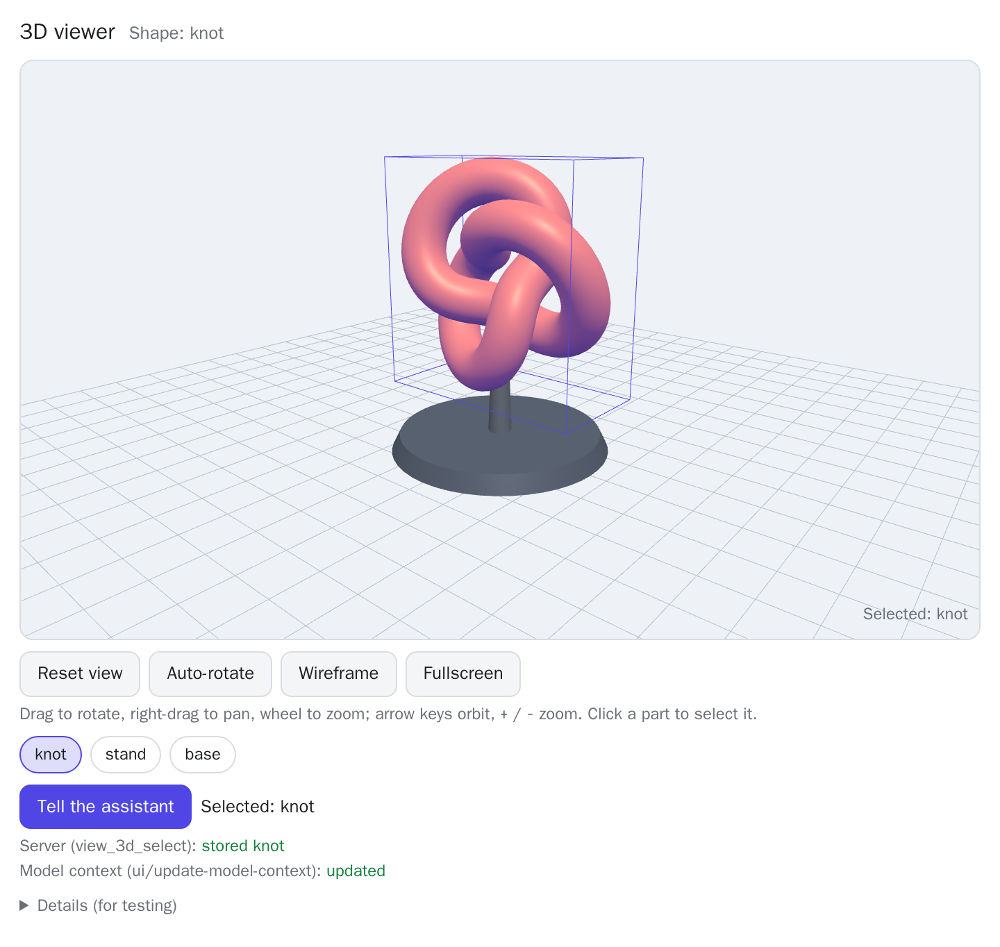 | 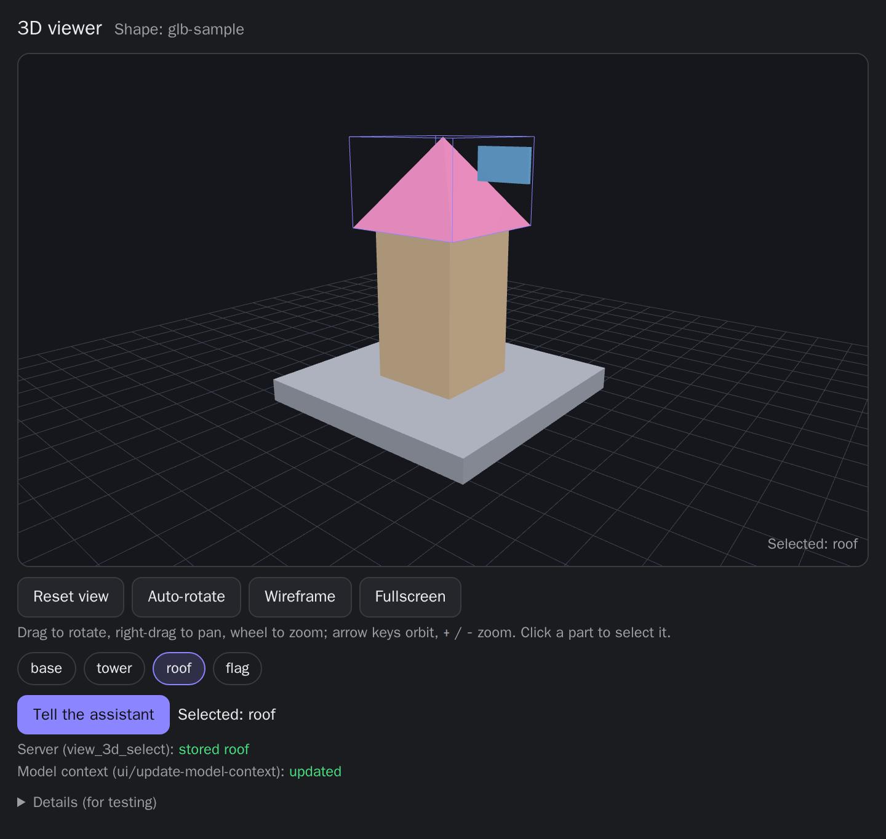 |

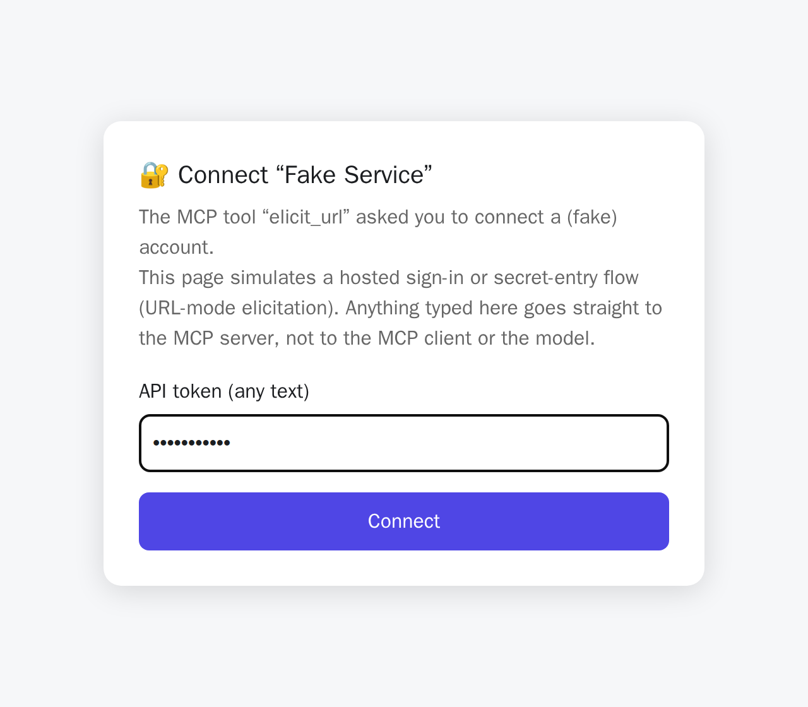

`pick_color` in Open WebUI 0.13.2. Open WebUI asks for two confirmations per answer: one for the app's tool call and one for its chat message. Dragging, image sampling through the file chooser and the EyeDropper API work inside its sandbox; browser storage does not. Details are in [docs/openwebui.md](docs/openwebui.md#colour-picker-pick_color).

| 1. The picker, rendered inline under the tool call | 2. OK: confirm the app's call to `pick_color_submit` |
| --- | --- |
| 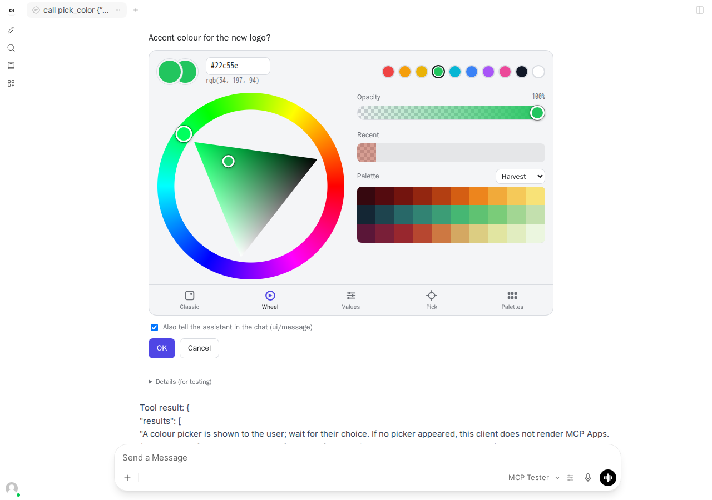 | 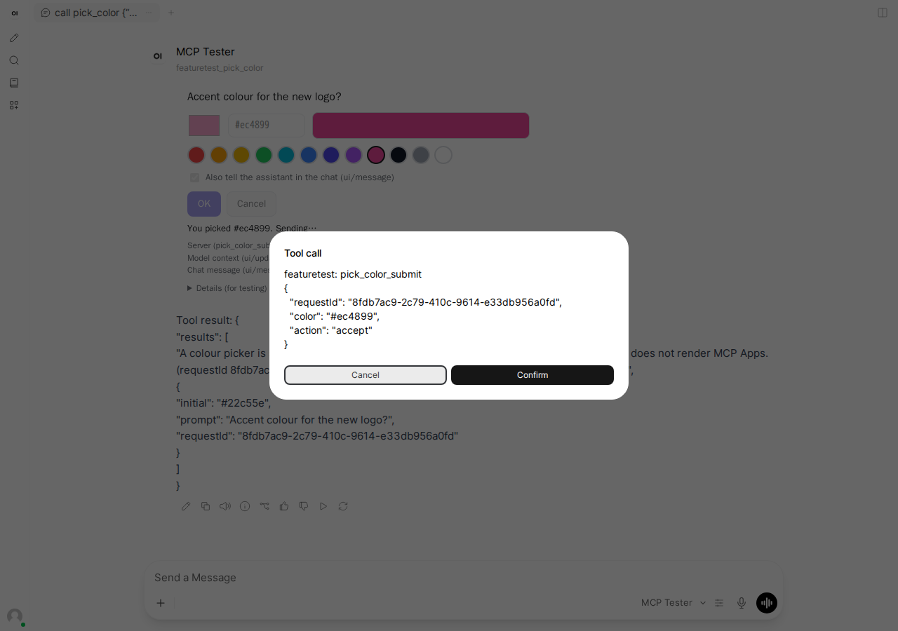 |
| **3. Confirm the chat message ("I picked …")** | **4. The model reads the answer with `pick_color_result`** |
| 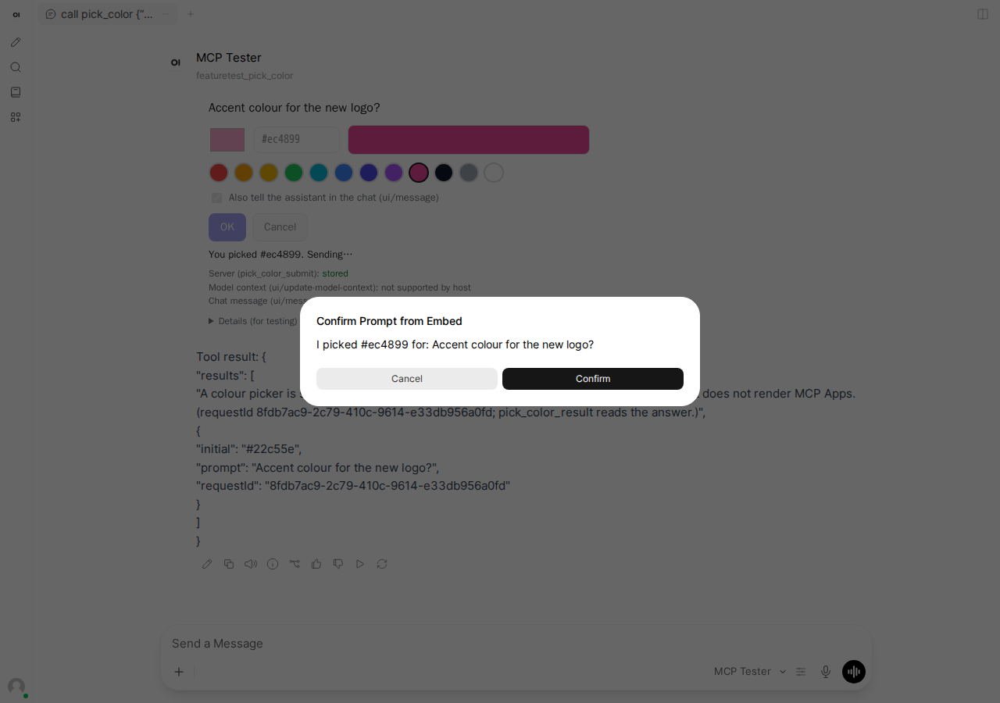 | 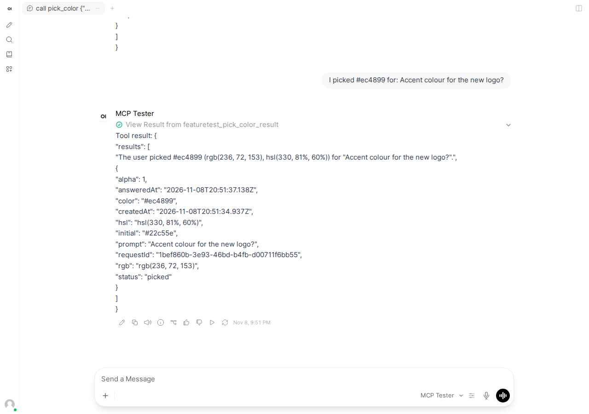 |
| **The Pick tab: a loaded image, a sampled colour** | |
| 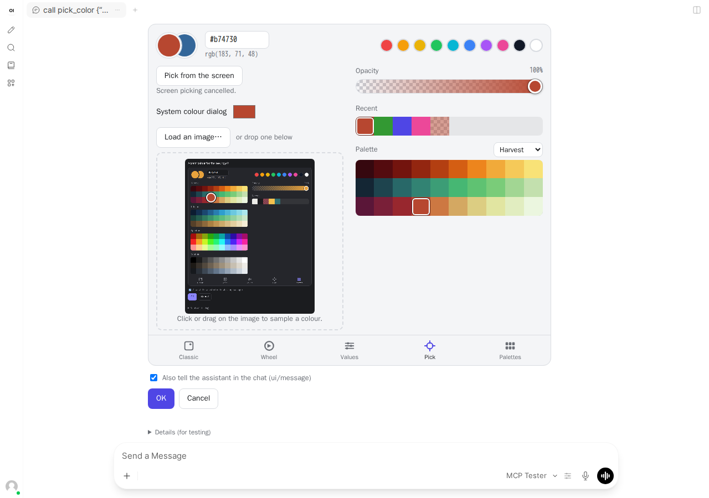 | |

## Capability logging

When a client connects, the server writes a summary to stderr. Some clients surface server stderr: Claude Desktop writes it to `mcp-server-feature-test.log`, VS Code shows it in the *Output* panel, and `docker logs` shows it for containers.

```text
2026-11-08T16:31:40.486Z INFO  [client.connected] client connected: smoke-test 0.0.1 (protocol 2025-11-25, legacy era, stdio)
    elicitation    form: yes   url: yes
    MCP Apps UI    yes  mimeTypes: text/html;profile=mcp-app
    sampling       no
    roots          no
    tasks          no
    extensions     (none besides UI)
    experimental   (none)
    raw            {"elicitation":{"form":{},"url":{}},"extensions":{"io.modelcontextprotocol/ui":{"mimeTypes":["text/html;profile=mcp-app"]}}}
2026-11-08T16:31:40.514Z INFO  [tool.input_required] elicit_confirm [legacy] asks for input: confirm (form)
2026-11-08T16:31:40.529Z INFO  [tool.result] elicit_confirm [legacy] user: confirm=accept; → ok (0 ms)
```

- **2025-era clients** are logged once per connection, after the `initialize` handshake (`client.connected`).
- **2026-07-28 clients** have no handshake. They are logged the first time a new combination of client info, version, protocol, transport and capabilities appears in a request envelope (`client.seen`). Repeat sightings only update the counters.
- **Each tool call** is logged with the user's answer (`accept`, `decline` or `cancel`) and the outcome (`ok`, `error` or `cancelled`).
- With `LOG_FORMAT=json` every event is one JSON line (`time`, `level`, `event`, `msg` plus structured fields such as `summary` and `capabilities`), which is easy to process with `jq`.
- `list_seen_clients` returns the same information through MCP, which helps when several frontends are tested against one HTTP server.

## Troubleshooting

| Symptom | Check |
| --- | --- |
| **No dialog appears** | Run `inspect_client`, or look at the `client.connected`/`client.seen` log line. If `elicitation form: no`, the client does not declare elicitation, and the tools return an explanatory error instead of a dialog. Some clients show elicitation only in agent mode or after you approve the tool call. |
| `elicit_url` says the client doesn't declare `url` | The client only supports form mode (`elicitation: {}` means form only). |
| The URL page doesn't load | In stdio mode the page is served on `FLOW_PORT` (default 3458; check the `flows.listening` log line for the actual port). In Docker, publish that port and set `FLOW_HOST=0.0.0.0`. Behind a proxy, set `PUBLIC_URL` (HTTP mode) or `FLOW_PUBLIC_URL` (stdio mode). |
| `elicit_url` seems to hang after you accepted | Some clients (e.g. Open WebUI) answer `accept` as soon as the link is opened; the tool then waits for the browser page to be submitted. Submit the page, or the tool returns an error after `FLOW_WAIT_MS` (default 5 min). |
| No graphical UI for `open_dialog_lab` | Check `MCP Apps UI` in `inspect_client`. The client must declare the `io.modelcontextprotocol/ui` extension with `text/html;profile=mcp-app`. |
| HTTP answers 403 | Host/Origin validation (DNS-rebinding protection). Add your hostname to `ALLOWED_HOSTS`. |
| HTTP answers 413, or a Dialog Lab upload fails | The request body was above `UPLOAD_MAX_BYTES` as base64 plus 1 MiB, or the file was above `UPLOAD_MAX_BYTES`. Raise the variable. If the server never logs `upload.received`/`upload.rejected`, the host refused the message before it reached the server. |
| The URL page answers 409 | The flow was already submitted once. Run the tool again for a new link. |
| HTTP answers 400 "Missing session" or 404 "Unknown session" | A 2025-era client sent a request without `initialize` first, or after the server restarted. Reconnect. |
| `elicit_url_legacy_push` fails | Expected on 2026-07-28 connections. Use `elicit_url`. |
| The client shows garbage or JSON parse errors (stdio) | Something wrote to stdout. This server never does; check wrapper scripts. |
| `dist/ui/dialog-lab.html` missing ("Dialog Lab UI not built") | Run `npm run build`. |

## Client support

Client support for these features changes quickly, so **the server itself is the source of truth**: connect your client and read the capability log or `inspect_client`. This repository tests the server against the official TypeScript SDK client (both protocol eras, stdio and HTTP) and the MCP App against the official `AppBridge` in headless Chromium. It does **not** run tests against Claude Desktop, Claude Code, VS Code or Cursor, so their support for form or URL elicitation and MCP Apps is not verified here. For Open WebUI, see the separate notes in [docs/openwebui.md](docs/openwebui.md).

If you test a client, the `client.connected`/`client.seen` log line and the results of `elicit_all_field_types` (types as received) make a good report.

## Development and tests

```sh
npm run build              # tsc + UI bundle
npm test                   # build + all suites (unit, integration, UI)
npm run test:unit
npm run test:integration   # spawns dist/stdio.js and dist/http.js (free ports)
npm run test:ui            # headless Chromium; skipped with a message if none is found
npm run screenshots        # regenerates docs/images/*.png
```

CI ([.github/workflows/docker-image.yml](.github/workflows/docker-image.yml)) runs the full suite, builds and smoke-tests the image, scans it with Trivy and publishes it; see [docs/docker.md](docs/docker.md#ci-and-published-images). See [docs/testing.md](docs/testing.md) for what each suite covers, and [docs/architecture.md](docs/architecture.md) for how the server is put together.

Source layout: `src/server.ts` (tools and factory), `src/files.ts` (generated sample files, upload decoding and limits), `src/clients.ts` (capability summary and seen-clients registry), `src/log.ts` (stderr logger), `src/flows.ts` (URL-elicitation pages), `src/httpServer.ts` + `src/http.ts` (HTTP), `src/stdio.ts` (stdio), `src/banner.ts` (container startup banner), `src/colorPicker.ts` (the `pick_color` tools), `src/colorMath.ts` (colour maths shared with the picker UI), `src/viewer3d.ts` (the `view_3d` tools and the sample GLB), `ui/` (the MCP Apps).
