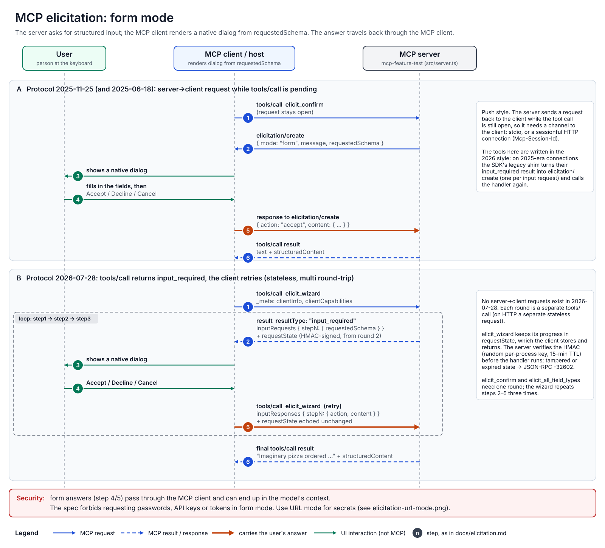
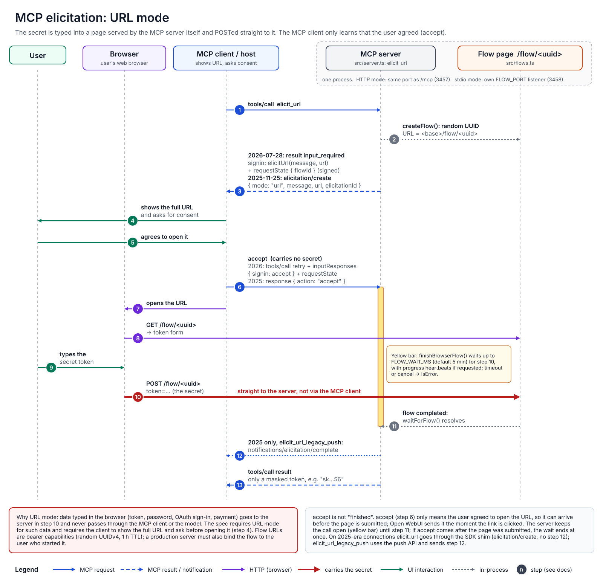

# Elicitation: form mode and URL mode

Elicitation lets a server ask the user something in the middle of a tool call. MCP has two modes, and this server exercises both:

| | Form mode | URL mode |
| --- | --- | --- |
| What the user sees | A native dialog that the **MCP client** draws from a JSON schema (`requestedSchema`) | A link that the client shows; the user opens it in the **browser** |
| Where the answer goes | Back to the server **through the MCP client** | Typed into a page the server hosts and sent **directly to the server**; the client only gets `accept` / `decline` / `cancel` |
| Use it for | Non-sensitive, structured input: confirmations, choices, names, settings | Secrets and anything that must not pass through the client or the model: API tokens, passwords, OAuth sign-in, payment |
| Client capability | `elicitation.form` (an empty `elicitation: {}` also means form) | `elicitation.url` |
| Tools here | `elicit_confirm`, `elicit_all_field_types`, `elicit_parallel`, `elicit_wizard` | `elicit_url`, `elicit_url_legacy_push` |
| Spec version | 2025-06-18 (richer enums/defaults: 2025-11-25) | 2025-11-25 |

**Security rule:** the spec forbids servers from requesting sensitive information (passwords, API keys, access tokens and the like) through form mode. A form answer is visible to the MCP client and can end up in the model's context. Secrets belong in URL mode.

Both modes work on both protocol generations. On **2025-era** connections (2025-06-18, 2025-11-25) the server sends a server→client `elicitation/create` request while the `tools/call` is still pending. On **2026-07-28** there are no server→client requests: the tool call **returns** `resultType: "input_required"`, and the client asks the user and **retries** the call with the answers. See [architecture.md](architecture.md#input_required-vs-push-elicitation-and-the-legacy-shim) for how one handler serves both eras.

The step numbers below match the numbered arrows in the diagrams.

## Form mode

Components: the **user**, the **MCP client/host** (renders the dialog), and the **MCP server** (`src/server.ts`).

### A. 2025-11-25 (and 2025-06-18): push request during `tools/call`

1. The client calls a tool, for example `tools/call elicit_confirm`. The request stays open.
2. The server sends `elicitation/create` with `mode: "form"`, a `message` and a `requestedSchema` (a flat JSON schema of strings, numbers, booleans and enums).
3. The client renders a native dialog from the schema.
4. The user fills it in and chooses Accept, Decline or Cancel (dismissing the dialog counts as Cancel).
5. The client answers the `elicitation/create` request with `{ action: "accept", content: { … } }` (or `decline` / `cancel` without content). **The user's data travels through the client here.**
6. The server finishes the tool and returns the `tools/call` result.

This needs a channel from the server to the client while the call is pending: stdio, or a sessionful Streamable HTTP connection (`Mcp-Session-Id`). The tools in this repo are written in the 2026 style; on 2025-era connections the SDK's legacy shim turns their `input_required` result into one `elicitation/create` per input request and calls the handler again with the answers.

### B. 2026-07-28: `input_required` and retry

1. The client calls the tool (`tools/call elicit_wizard`). Client info and capabilities travel in `_meta` of every request.
2. The server returns a result with `resultType: "input_required"` and `inputRequests`, e.g. `{ step1: { …elicitation with requestedSchema… } }`. From the second round on, it also returns a `requestState`.
3. The client shows the dialog.
4. The user answers.
5. The client **retries** the same `tools/call` with `inputResponses` (`{ step1: { action, content } }`) and echoes `requestState` unchanged. **The user's data travels through the client here too.**
6. When nothing more is needed, the server returns the final result.

`elicit_confirm` and `elicit_all_field_types` need one round. `elicit_parallel` sends two input requests in one round. `elicit_wizard` loops through steps 2–5 three times (basics, toppings, confirmation) and keeps its progress in `requestState`. That state is HMAC-signed with a random per-process key and a 15-minute TTL, and the server rejects tampered or expired state with JSON-RPC `-32602` before the handler runs ([details](architecture.md#requeststate-signing)). Every round is an independent request, so on HTTP the 2026-07-28 path is stateless.

## URL mode

Components: the **user**, the user's **browser**, the **MCP client/host**, the **MCP server** (`elicit_url` / `elicit_url_legacy_push` in `src/server.ts`) and the server's **flow page** `/flow/<uuid>` (`src/flows.ts`). The flow page belongs to the same process as the MCP server:

- **HTTP mode:** served by the main HTTP server on the same port as `/mcp` (default 3457). Links use `PUBLIC_URL` as their base.
- **stdio mode:** a small separate listener started on first use, on `FLOW_PORT` (default 3458, a free port if busy), bound to `FLOW_HOST`. Links use `FLOW_PUBLIC_URL` if set.

Steps:

1. The client calls `tools/call elicit_url`.
2. The server creates a flow (`createFlow()`): a random UUIDv4 and the URL `<base>/flow/<uuid>`. Flows expire after one hour.
3. The server issues the URL elicitation:
   - **2026-07-28:** result `input_required` with `inputRequests.signin` = `elicitUrl(message, url)`, plus a signed `requestState` that holds the flow ID.
   - **2025-11-25:** `elicitation/create` with `mode: "url"`, `message`, `url` and `elicitationId`.
4. The client shows the message and the **full URL** and asks the user whether to open it (the spec requires this consent).
5. The user agrees.
6. The client answers `accept`. This carries no secret.
   - **2026-07-28:** it retries `tools/call` with `inputResponses: { signin: { action: "accept" } }` and the `requestState`.
   - **2025-11-25:** it answers the `elicitation/create` request with `{ action: "accept" }`.
7. The client (or the user, by clicking the link) opens the URL in the browser.
8. The browser loads `GET /flow/<uuid>`, a small form asking for a (fake) API token.
9. The user types the token.
10. The browser sends `POST /flow/<uuid>` with `token=…` **directly to the MCP server**. The token never passes through the MCP client or the model. POST bodies are capped at 64 KiB.
11. The flow page marks the flow complete, and `waitForFlow()` in the waiting tool call resolves.
12. **2025-era, `elicit_url_legacy_push` only:** the server sends `notifications/elicitation/complete` with the `elicitationId`, so the client can close its dialog by itself. `elicit_url` does not send it, and 2026-07-28 has no such notification.
13. The server returns the tool result. It contains only a **masked** token (first two and last two characters, e.g. `sk…56`).

### `accept` does not mean "finished"

In URL mode `accept` means "the user agreed to open the URL", so it can arrive before the page is submitted. Open WebUI, for example, sends `accept` the moment the link is clicked ([details](openwebui.md#elicitation-url)). The server therefore does not treat step 6 as completion: `finishBrowserFlow()` keeps the call open (the yellow bar in the diagram) until the page is submitted, for up to `FLOW_WAIT_MS` (default 300000 ms = 5 minutes). While it waits it sends progress notifications every 5 s if the client supplied a progress token. If the page was already submitted when `accept` arrives, the wait ends immediately. On timeout or cancellation the tool returns `isError` and asks you to run it again.

If the user declines or cancels in step 5/6, the tool returns at once with that answer.

### Which tool on which protocol

| Tool | 2026-07-28 | 2025-era |
| --- | --- | --- |
| `elicit_url` | `input_required` + `elicitUrl`, retry with `inputResponses` | SDK legacy shim sends `elicitation/create` (mode `url`); no completion notification |
| `elicit_url_legacy_push` | Returns an explanatory `isError` (no server→client requests exist) | Push API: `elicitation/create` (mode `url`, `elicitationId`) and `notifications/elicitation/complete` after step 10 |

### Security notes for URL mode

- The flow URL is a bearer capability: whoever has it can complete the flow. Don't post it anywhere public.
- This demo does not bind the flow to the user who started it. A production server must check that the browser session completing the flow belongs to the same user as the MCP session that started it, to prevent phishing and session fixation (the spec's URL-mode security requirements).
- See [architecture.md, Security notes](architecture.md#security-notes) for the rest (Host/Origin validation, no authentication).

## Editing the diagrams

The diagrams live in [`docs/diagrams/`](diagrams/):

| Diagram | Source (VectorCraft) | PNG | SVG |
| --- | --- | --- | --- |
| Form mode | [elicitation-form-mode.vectorcraft](diagrams/elicitation-form-mode.vectorcraft) | [png](diagrams/elicitation-form-mode.png) | [svg](diagrams/elicitation-form-mode.svg) |
| URL mode | [elicitation-url-mode.vectorcraft](diagrams/elicitation-url-mode.vectorcraft) | [png](diagrams/elicitation-url-mode.png) | [svg](diagrams/elicitation-url-mode.svg) |
| Architecture overview ([architecture.md](architecture.md)) | [architecture-overview.vectorcraft](diagrams/architecture-overview.vectorcraft) | [png](diagrams/architecture-overview.png) | [svg](diagrams/architecture-overview.svg) |
| MCP Apps flow ([architecture.md](architecture.md#mcp-apps-flow)) | [mcp-apps-flow.vectorcraft](diagrams/mcp-apps-flow.vectorcraft) | [png](diagrams/mcp-apps-flow.png) | [svg](diagrams/mcp-apps-flow.svg) |

The `.vectorcraft` files are the editable sources (uncompressed JSON, VectorCraft 0.22 native format). Open one in VectorCraft, edit it, save it, and export again:

- **PNG:** File › Export, format PNG, 1 pixel per point (1600 px wide), or the `export` tool with `format: "png", scale: 1`.
- **SVG:** export as SVG with live text (the text uses the Inter font and falls back to `sans-serif`). Exporting with text outlined makes the file about 60 times larger.

Keep the step numbers in the diagrams and in the pages that describe them (this page, and architecture.md for the MCP Apps flow) in sync.
