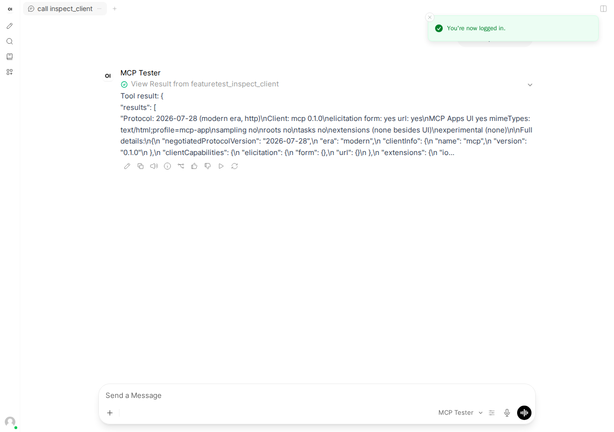
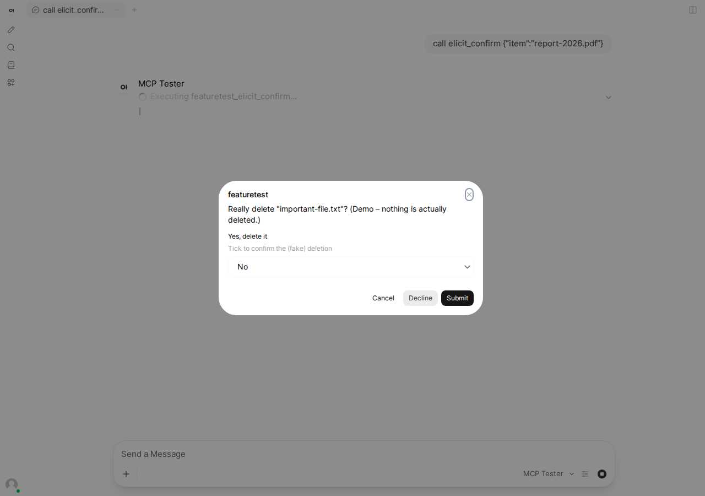
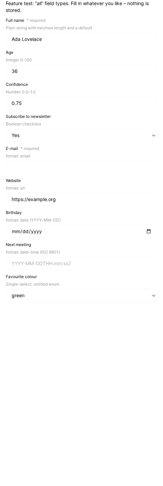
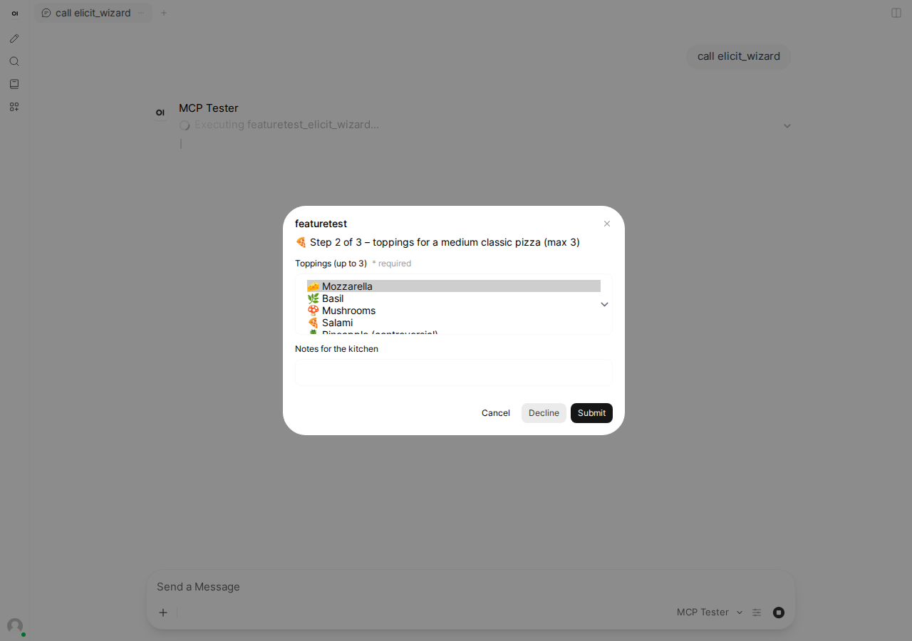
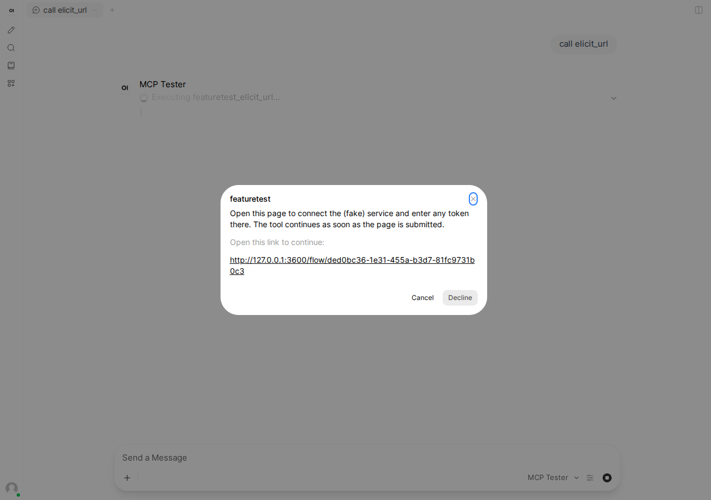
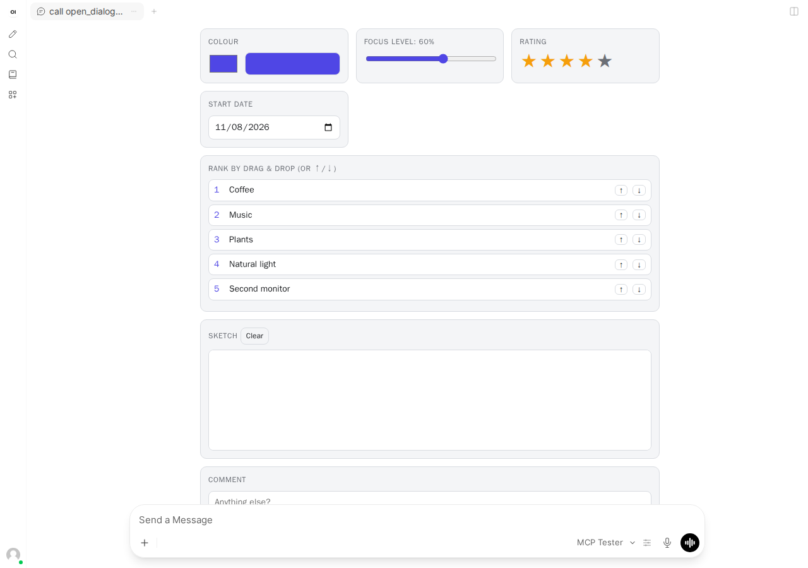

# Open WebUI and this server

Status as of **2026-11-08**. Tested hands-on with **Open WebUI 0.13.2** (PyPI, released 2026-11-08), which bundles the **Python `mcp` SDK 2.3.0** and the frontend package **`@modelcontextprotocol/ext-apps` 2.0.4**. Source read at the git tag `v0.13.2`.

In short:

- Open WebUI has a **native MCP client** for **Streamable HTTP** (added in 0.6.31, 2025-09-25). It does not speak stdio or the old SSE transport. Those still need the **mcpo** OpenAPI proxy.
- **Elicitation works**, in both **form** and **URL** mode, on both protocol generations:
  - 2026-07-28: `input_required` / `inputRequests`, including several requests in one round and wizards that take several rounds.
  - 2025-11-25: push-style `elicitation/create`.

  It shipped without a changelog entry in **0.12.0** (2026-10-10). The 2026-07-28 support came in **0.12.4** (2026-10-25).
- **MCP Apps** (`io.modelcontextprotocol/ui`, `text/html;profile=mcp-app`) are rendered inline in the chat since **0.13.0** (2026-11-02). Since **0.13.1**, apps can also post `ui/message`.
  - Supported: `tools/call` (always behind a confirmation dialog), `resources/read` and `resources/list`, `ui/open-link`, `ui/message` (behind a confirmation dialog), size changes, and `ui/request-display-mode`, which always answers `inline`.
  - Not supported: `ui/update-model-context` and `ui/download-file` return *Method not found*. Fullscreen and PiP don't exist.
- **Not supported:** sampling, roots, progress notifications, log messages (`notifications/message`), `notifications/elicitation/complete`, and MCP-UI (`@mcp-ui`) resources.
- Through **mcpo**, every interactive feature is lost. The client declares no capabilities, and resources (and with them MCP Apps) are not proxied.
- **Automated tests and screenshots are feasible and built.** `openwebui/` holds a script-based harness: Open WebUI from pip, a deterministic fake LLM, a JSON-RPC trace proxy and a Playwright driver. All 11 scenarios pass, and the screenshots below come from it.

Contents:

- [1. Support matrix](#1-support-matrix)
- [2. How Open WebUI connects to MCP](#2-how-open-webui-connects-to-mcp)
- [3. Details and observed behaviour](#3-details-and-observed-behaviour)
- [4. mcpo: what is lost](#4-mcpo-what-is-lost)
- [5. Open WebUI's own interaction mechanisms (mapping)](#5-open-webuis-own-interaction-mechanisms-mapping)
- [6. Issues, PRs, roadmap](#6-issues-prs-roadmap)
- [7. Connecting this server to Open WebUI step by step](#7-connecting-this-server-to-open-webui-step-by-step)
- [8. Workarounds and notes for server authors](#8-workarounds-and-notes-for-server-authors)
- [9. Automated tests and screenshots (harness)](#9-automated-tests-and-screenshots-harness)
- [10. Sources](#10-sources)

Legend for the evidence column:

- **verified**: observed hands-on with 0.13.2, through the harness's JSON-RPC trace and the UI.
- **source**: read in the `v0.13.2` source.
- **docs**: from docs.openwebui.com.
- **inferred**: deduced, not tested.

---

## 1. Support matrix

| MCP feature | Open WebUI 0.13.2 (native MCP) | Since | Evidence |
|---|---|---|---|
| Transport: Streamable HTTP | Yes. This is the only native transport. | 0.6.31 (2025-09-25) | source `utils/mcp/client.py` uses only `streamable_http_client`; CHANGELOG 0.6.31; verified |
| Transport: stdio / legacy HTTP+SSE | No (use mcpo) | – | source; docs ("check out mcpo… stdio or SSE") |
| Protocol 2026-07-28 (stateless, `server/discover`, per-request `_meta` envelope) | Yes. `Client(mode='auto')` probes `server/discover` and falls back to `initialize` if the server is legacy. | 0.12.4 (2026-10-25, PR #33087) | verified: the trace shows `server/discover` and `MCP-Protocol-Version: 2026-07-28`, and `inspect_client` reports `2026-07-28` |
| Protocol 2025-11-25 (initialize handshake) | Yes (fallback) | before 0.12.4 this was the only mode (SDK 1.27.2) | verified with the trace proxy in `FORCE_LEGACY=1` mode: `initialize` with `protocolVersion: 2025-11-25` |
| `clientInfo` | `{"name":"mcp","version":"0.1.0"}`, the SDK default. Open WebUI doesn't set its own. | – | verified |
| Elicitation, form mode | **Yes.** Modal titled with the connection ID. Field types: string (text, email, url, date, a text box for date-time), number and integer, boolean (Yes/No select), single-select enums (`enum`, `oneOf`, `enumNames`), multi-select arrays (`items.enum` / `anyOf`). Answers are validated against the schema with `jsonschema` before they are sent. | 0.12.0 (2026-10-10, commit c7b5edc7; not in the changelog) | verified (`elicit_confirm`, `elicit_all_field_types`, `elicit_wizard`); source `ElicitationDialog.svelte`, `MCPClient.elicit` |
| Elicitation, URL mode | **Yes.** The dialog shows the link. **Clicking the link immediately answers `accept`** and closes the dialog. Only http(s) URLs without credentials are allowed; anything else is cancelled. | 0.12.0 | verified (`elicit_url`, `elicit_url_accept`, `elicit_url_legacy_push`) |
| Elicitation via 2026-07-28 `input_required` (`inputRequests`, `requestState`) | **Yes**, driven by the SDK's input-required loop (at most 10 rounds). Several requests in one round are shown **one after another**, not together. | 0.12.4 | verified (`elicit_parallel`: two modals in sequence; `elicit_wizard`: 3 rounds) |
| Elicitation via 2025-11-25 `elicitation/create` push | Yes | 0.12.0 | verified (trace shows `elicitation/create`) |
| `notifications/elicitation/complete` | Ignored. The dialog has already closed on click. | – | source (no message handler); verified (nothing visible) |
| Where elicitation is available | Only for chats running in an **open browser tab** (needs a Socket.IO session). Plain `/api/chat/completions` API calls and MCP App RPCs connect **without** the elicitation capability. Timeout: 120 s, or `WEBSOCKET_EVENT_CALLER_TIMEOUT` if lower. | – | verified (trace: API calls and app RPCs declare only the UI extension); source `utils/tools.py` (`event_caller` only if `metadata.session_id`); docs |
| Sampling (`sampling/createMessage`) | No (not declared) | – | verified (`sampling` absent); source (no `sampling_callback`) |
| Roots | No (not declared) | – | verified; source |
| Progress (`notifications/progress`) | No. Open WebUI sends no `progressToken`. | – | verified (`slow_task` reports "Client did not request progress") |
| Logging (`notifications/message`, `logging/setLevel`) | Not shown. The server's log notifications are received and dropped, and `setLevel` is never sent. | – | verified (trace shows `notifications/message`, no UI) |
| Server `instructions` | Yes. Appended to the system prompt as `MCP server "<id>" instructions:`. | (version not checked) | docs; source (`client.instructions`) |
| `structuredContent` | Passed to the model as JSON text when it differs from the text blocks | 0.12.0 | docs; verified (tool results contain the JSON) |
| Tool `_meta.ui.visibility` | Respected. App-only tools (`dialog_lab_submit`) are hidden from the model. Tools without `app` can't be called by apps. | 0.13.0 | verified (the fake LLM's tool list never contains `dialog_lab_submit`) |
| **MCP Apps** (`_meta.ui.resourceUri` → `ui://`, `text/html;profile=mcp-app`) | **Yes.** Rendered inline under the tool call in a sandboxed `srcdoc` iframe (`allow-scripts allow-downloads allow-popups`, opaque origin, CSP from `_meta.ui.csp` plus `IFRAME_CSP`, 5 MB maximum). Needs a stable `WEBUI_SECRET_KEY`. Declared as the extension `io.modelcontextprotocol/ui` with `mimeTypes: ["text/html;profile=mcp-app"]`. | 0.13.0 (2026-11-02) | verified (`open_dialog_lab` renders the Dialog Lab); source `MCPApp.svelte`, `utils/mcp/apps.py` |
| App → host `tools/call` | Yes, **every call needs user confirmation** in a "Tool call" dialog | 0.13.0 | verified |
| App → host `ui/message` | Yes, after a "Confirm Prompt from Embed" dialog. Text only. The text is submitted as the user's next chat message. | 0.13.1 (PR #33907) | verified |
| App → host `ui/update-model-context` | **No** (`Method not found`) | – | verified |
| App → host `ui/request-display-mode` | Answers `inline` (only `availableDisplayModes: ["inline"]`) | 0.13.0 | verified ("Display mode is now: inline") |
| App → host `ui/download-file` | **No** (`Method not found`) | – | verified |
| App → host `ui/open-link`, `resources/read` / `resources/list` | Yes. Links are http(s) only. | 0.13.0 | source |
| Host → app `ui/notifications/tool-input`, `tool-result`, `host-context-changed`, `resource-teardown` | Yes. Host context: `theme`, `platform: web`, `displayMode: inline`, `locale`, `timeZone`, `toolInfo`, `containerDimensions`. | 0.13.0 | source; verified (the app shows the light theme and tool result) |
| Apps needing `localStorage` / same origin | No (the `srcdoc` iframe is opaque) | – | source comment in `MCPApp.svelte` |
| MCP-UI (`@mcp-ui`, `rawHtml` / `externalUrl` / `remoteDom` resources) | **No** | – | source (no matches); inferred: such resources only reach the model as text |
| OpenAPI tool servers returning HTML (`Content-Disposition: inline`) | Rendered as an "embed" iframe (Open WebUI's own Rich UI mechanism). Doesn't apply to MCP. | 0.7/0.8 | source `middleware.py` |

## 2. How Open WebUI connects to MCP

| Route | What it is | Transports | Auth | Landed |
|---|---|---|---|---|
| **Native MCP**: Admin Settings → **External Tools** / Integrations → *+ Add Connection* → Type **MCP (Streamable HTTP)** | Open WebUI is the MCP client (Python `mcp` SDK). Since 0.8.11 (2026-03-25) only administrators can configure it. | Streamable HTTP only | None, Bearer key, session (forwards the Open WebUI user's token), system OAuth, OAuth 2.1 with dynamic client registration (0.6.31), OAuth 2.1 static client (0.8.11), custom headers (0.6.3x), user-info forwarding headers (`ENABLE_FORWARD_USER_INFO_HEADERS`) | 0.6.31 (2025-09-25, PR #16651, issue #15932) |
| **OpenAPI tool server**, e.g. **mcpo** | mcpo (an `open-webui` project) is an MCP client that exposes each MCP tool as a REST endpoint with an OpenAPI schema. Open WebUI calls it like any OpenAPI tool server. | mcpo → MCP: stdio, SSE, Streamable HTTP. Open WebUI → mcpo: HTTP. | API key on mcpo | Announced in 0.6.0 (2025-03-31). mcpo 0.0.20 is the latest (2026-02-27). |

Also good to know:

- **One MCP session per chat request.** The native client connects (or runs `server/discover`) at the start of every completion request, lists the tools and disconnects afterwards. Every MCP App RPC gets its own connection as well (verified in the trace: several connects per chat). On 2025-11-25 servers this means session state does not survive from one chat turn to the next.
- **Tool names reach the model prefixed with the connection ID**, for example `featuretest_inspect_client` (verified). Names longer than 64 characters are shortened with a hash (0.12.0).
- The config can be set with the env var `TOOL_SERVER_CONNECTIONS` (a JSON list) or with `POST /api/v1/configs/tool_servers`.
- MCP tools run only with a model that uses **native function calling**, which is the default. The legacy prompt-based mode has to be switched on explicitly (`function_calling: "legacy"`).

## 3. Details and observed behaviour

### Capabilities as seen by `inspect_client`

Chat in the browser, 2026-07-28 (per-request `_meta` envelope):

```json
{
  "negotiatedProtocolVersion": "2026-07-28",
  "clientInfo": { "name": "mcp", "version": "0.1.0" },
  "clientCapabilities": {
    "elicitation": { "form": {}, "url": {} },
    "extensions": { "io.modelcontextprotocol/ui": { "mimeTypes": ["text/html;profile=mcp-app"] } }
  }
}
```

With the discovery probe refused (trace proxy with `FORCE_LEGACY=1`), the same capabilities arrive in `initialize` with `protocolVersion: "2025-11-25"`.

When the same model is called through the REST API (`POST /api/chat/completions` without a browser session), and for MCP App RPCs, `elicitation` is **absent**. Only the UI extension is declared, so elicit tools would fail there.



The fake LLM in the harness just echoes the tool result ("Tool result: …"). A real model would summarise it.

### Elicitation (form)



How the form looks and behaves:

- Booleans are rendered as a *Select / Yes / No* dropdown, not as a checkbox.
- Multi-selects are native `<select multiple>` lists.
- `date-time` fields are a free text box with a placeholder.
- Required fields and `minLength`/`maxLength` are enforced by the browser.
- Field descriptions are shown.
- There are three buttons: **Cancel** (sends `cancel`), **Decline** (sends `decline`) and **Submit** (sends `accept`). Closing the modal with × also sends `cancel`.
- If the schema contains a type the dialog can't render, it shows "Unsupported input format" and offers only Cancel and Decline.
- The answers are validated server-side against the requested schema (`Draft202012Validator` with a format checker and no `$ref` resolution). If validation fails, the request is cancelled.

| All field types (`elicit_all_field_types`) | Wizard, step 2 of 3 (`elicit_wizard`) |
|---|---|
|  |  |

The two requests of one `input_required` round (`elicit_parallel`) are shown **one after another** ([screenshot](images/openwebui-elicit-parallel-dialog.png)).

### Elicitation (URL)



The dialog has only **Cancel** and **Decline**. The link itself is the accept action: Open WebUI answers `accept` the moment the link is clicked and closes the dialog, and the page opens in a new tab.

For the 2025-11-25 specification, `accept` in URL mode means "the user agreed to open the URL", so this is conforming client behaviour. The `elicit_url` and `elicit_url_legacy_push` tools therefore don't treat `accept` as "finished": after `accept` they wait (up to `FLOW_WAIT_MS`, default 5 min) until the browser page is submitted, then complete. Verified in Open WebUI 0.13.2 on both 2026-07-28 and 2025-11-25 connections ([screenshot](images/openwebui-elicit-url-result.png)). See [section 8](#8-workarounds-and-notes-for-server-authors).

### MCP Apps

The Dialog Lab rendered inline:



| App → host request | Result in Open WebUI 0.13.2 |
|---|---|
| `tools/call dialog_lab_submit` | A "Tool call" confirmation dialog appears ([screenshot](images/openwebui-mcp-app-toolcall-confirm.png)). After *Confirm*, the app shows "✅ Stored submission #1". |
| `ui/update-model-context` | `Method not found` |
| `ui/request-display-mode` (fullscreen) | Answer `inline` |
| `ui/download-file` | `Method not found` |
| `ui/message` | A "Confirm Prompt from Embed" dialog appears ([screenshot](images/openwebui-mcp-app-message-confirm.png)), then the text is sent as the next user message ([screenshot](images/openwebui-mcp-app-after-message.png)). |

The app runs from an opaque `srcdoc` origin. Every app request goes through the Open WebUI backend (`POST /api/v1/tools/id/server:mcp:<id>/mcp/app/rpc`), authenticated with the user's token plus an HMAC binding to the server and tool. That backend opens a fresh MCP connection without the elicitation capability for each request, so **a tool called from an app cannot elicit**.

## 4. mcpo: what is lost

mcpo 0.0.20 was tested hands-on against this server's Streamable HTTP endpoint.

- **Install trap:** mcpo 0.0.20 declares `mcp>=1.17.0` with no upper bound. With today's `mcp` 2.3.0 it crashes on start (`ImportError: cannot import name 'streamablehttp_client'`), and with a current FastAPI it crashes too (`FastAPI.__init__() got an unexpected keyword argument 'ssl_certfile'`). It works when dependencies are resolved as of its release date: `uv pip install mcpo==0.0.20 --exclude-newer 2026-02-28` (that resolves `mcp` 1.26.0 and FastAPI 0.134.0).
- It uses `ClientSession(reader, writer)` with **no callbacks**. `inspect_client` through mcpo reports protocol `2025-11-25`, `clientCapabilities: {}`, and `clientInfo` `mcp 0.1.0`. As a result:
  - **No elicitation.** `elicit_confirm` and `elicit_url` come back from mcpo as HTTP 500 with this server's "did not declare form-mode elicitation support" message. A plain request/response OpenAPI call has no channel to ask the user mid-call. mcpo would have to implement the dialog itself, and Open WebUI has no OpenAPI-level equivalent.
  - **No sampling, roots, progress or logging.** Notifications have nowhere to go.
  - **No MCP Apps.** mcpo does not proxy resources (`# TODO: Handle embedded resources`; feature PRs #205 and #206 have been open since 2025-07), and Open WebUI only renders apps for native MCP connections. `open_dialog_lab` returns only its text.
  - **`_meta.ui.visibility` is ignored.** The app-only tool `dialog_lab_submit` is exposed to the model as `/dialog_lab_submit`.
  - Only **one session per mcpo process**, shared by all users, and it doesn't negotiate 2026-07-28.
- What mcpo is still good for: bridging **stdio** servers (`mcpo -- node dist/stdio.js`) or old SSE servers into Open WebUI, for plain tools only.

## 5. Open WebUI's own interaction mechanisms (mapping)

| MCP feature | Closest Open WebUI-native equivalent (for Python Tools/Functions written inside Open WebUI) |
|---|---|
| Elicitation (form, yes/no) | `await __event_call__({"type": "confirmation", "data": {"title", "message"}})` and `{"type": "input", "data": {"title", "message", "placeholder"}}`: a modal confirm dialog or a single-line input dialog. Open WebUI also has a model-callable built-in **`ask_user`** tool (in the changelog since at least 0.11.2) (1–3 questions shown in the chat). These survive page reconnects since 0.12.4. Open WebUI routes MCP elicitation through the same `__event_call__` pipe as the event type `request:elicitation`. |
| Elicitation (URL) | No direct equivalent. A tool can emit a link in a message or status. OAuth for tool servers is built in. |
| MCP Apps | **Rich UI embeds**: a Python tool returns `HTMLResponse(..., headers={"Content-Disposition": "inline"})`, or an OpenAPI server returns `text/html` with `Content-Disposition: inline`. The page is rendered as an iframe "embed" in the message, without the MCP Apps JSON-RPC bridge. Actions (buttons under messages) and `__event_emitter__` (status, message, citation, notification) also exist. |
| Progress / logging | `__event_emitter__({"type": "status", "data": {"description", "done"}})` from Python tools. External (OpenAPI/MCP) servers can post events to the event-emitter endpoint when `ENABLE_FORWARD_USER_INFO_HEADERS` forwards the chat and message IDs (0.8.0). This is Open WebUI-specific, not MCP progress. |
| Sampling | None for MCP. Python Functions can call models internally (`generate_chat_completion`). |

## 6. Issues, PRs, roadmap

| Item | State | Notes |
|---|---|---|
| Issue #15932, PR #16651: native MCP (Streamable HTTP) plus OAuth 2.1 | merged → 0.6.31 | |
| PR #21781 "Implement MCP Elicitation Modal" (rmagur1203) | closed, **not merged** (2026-08-20) | |
| PR #27158 "add MCP elicitation support for server-enforced user confirmation" (PedroFCM) | closed, **not merged** (2026-10-10) | Superseded by the maintainer's own implementation (commit c7b5edc7, shipped in 0.12.0). Commenters confirmed elicitation works in 0.12.0. |
| Issue #20995 "Support for MCP Apps Extension" (2026-01-28) | closed as completed the same day | MCP Apps actually shipped in 0.13.0. Further context in discussions #21040 and #20915. |
| Issue #29164 "Make MCP a first-class native protocol: MCP Apps, progress, sampling, per-user auth" | closed (2026-08-28) | A maintainer replied that most of it can be implemented as tools and that first-party support needs discussion. MCP Apps were added later anyway. **Progress and sampling: no open work found.** |
| Issue #29778, PR #33087: protocol 2026-07-28 | merged → 0.12.4 | |
| PR #33907: MCP Apps can send messages to the chat | merged → 0.13.1 | |
| `ui/update-model-context`, display modes, `ui/download-file`, roots, logging, progress, `elicitation/complete` | **no issue or PR found** (searched 2026-11-08) | Candidates for upstream feature requests |

## 7. Connecting this server to Open WebUI step by step

1. Run the server over HTTP: `npm run build && npm run start:http` (`http://127.0.0.1:3457/mcp`). If Open WebUI runs in Docker, start it with `HOST=0.0.0.0` and use `http://host.docker.internal:3457/mcp`, or put both in one network. On `127.0.0.1` the server rejects non-localhost `Host` headers.
2. In Open WebUI 0.13.x, as an administrator, go to **Admin Settings → External Tools (Integrations)** and click **+ Add Connection**:
   - Type: **MCP (Streamable HTTP)**
   - URL: `http://127.0.0.1:3457/mcp`
   - Auth: **None**
   - Connection ID: for example `featuretest`. It appears as the dialog title and as the tool-name prefix.
3. Set a stable **`WEBUI_SECRET_KEY`**. MCP Apps refuse to work without one.
4. In a chat, enable the server in the **+ / Tools** menu, or add it to a workspace model's default tools. Use a model with function calling (native mode is the default).
5. Ask the model to "call inspect_client", "try elicit_confirm" or "open the dialog lab". Keep the chat open in the browser tab: elicitation dialogs only appear there.
6. Alternatively, preconfigure the connection with an env var (as `openwebui/start.sh` does):

   ```sh
   TOOL_SERVER_CONNECTIONS='[{"type":"mcp","url":"http://127.0.0.1:3457/mcp","path":"","auth_type":"none","key":"","info":{"id":"featuretest","name":"MCP Feature Test"},"config":{"enable":true}}]'
   ```

   Add `ENABLE_PERSISTENT_CONFIG=False` so the env var wins over the database.
7. For stdio or Open WebUI versions before 0.6.31, use mcpo: `mcpo --port 8000 -- node dist/stdio.js`, then add `http://localhost:8000` as an **OpenAPI** connection. Only plain tools work this way ([section 4](#4-mcpo-what-is-lost)).

## 8. Workarounds and notes for server authors

- **URL elicitation semantics.** Open WebUI sends `accept` when the link is clicked, before the user has finished the page. The tools that need a result should wait for the out-of-band flow after `accept`, not expect it to be finished already:
  - **2026-07-28:** after `accept`, keep the retried request open until the flow finishes (what this server does), or return another `input_required` round (e.g. a follow-up form "Done?").
  - **2025-11-25:** wait for the flow and send `notifications/elicitation/complete`.

  This server waits for the page after `accept` (both tools, both eras), sends progress heartbeats while it waits if the client asked for progress, gives up with an error after `FLOW_WAIT_MS` (default 300000 ms), and stops waiting when the call is cancelled.
- **No `ui/update-model-context`.** Use `ui/message` (which needs user confirmation) or `tools/call` into an app-only tool that stores the data, as `dialog_lab_submit` and `dialog_lab_results` do here. Both work in Open WebUI.
- **No fullscreen.** Design apps for inline width. The iframe grows to the reported height, 100–10000 px.
- **No browser storage in apps.** The iframe has an opaque origin.
- **Elicitation only works in an interactive browser chat.** Tools that elicit should degrade gracefully when the capability is absent (API usage, app-initiated calls, mcpo).
- **Every chat turn is a fresh MCP session or connection.** Keep state server-side by key, or with the 2026-07-28 `requestState`.

## 9. Automated tests and screenshots (harness)

**Feasible, and prototyped in `openwebui/`.** No Docker was available in the sandbox, so the tested path runs Open WebUI from its pip package in a `uv` venv (Python 3.12). Open WebUI 0.13.2 requires Python ≥3.11 and <3.13. A Docker Compose sketch is included but **untested**.

| File | Purpose |
|---|---|
| `openwebui/start.sh` / `stop.sh` | Installs `open-webui==$OWUI_VERSION` (default 0.13.2) into `$OWUI_VENV` if it's missing, then starts the MCP server (:3600), the fake LLM (:3601), Open WebUI (:3602, `WEBUI_AUTH=False`, connections via `TOOL_SERVER_CONNECTIONS`, `ENABLE_PERSISTENT_CONFIG=False`) and two trace proxies (:3603 modern, :3604 `FORCE_LEGACY=1`). Finally it runs `setup.mjs`. State and logs go to `$WORK` (default `/tmp/owui-mcp-test`). |
| `openwebui/fake-llm.mjs` | Dependency-free OpenAI-compatible endpoint (`/v1/models`, `/v1/chat/completions`, streaming and non-streaming). `call <tool> {json}` in the last user message produces exactly one tool call to the offered tool whose name ends with `<tool>`. A tool result produces the text "Tool result: …". |
| `openwebui/mcp-trace-proxy.mjs` | Logging reverse proxy. Prints one JSON line per JSON-RPC message (method, protocol version, capabilities, `_meta` envelope, `resultType`, `inputRequests`). `FORCE_LEGACY=1` refuses `server/discover` to force the 2025-11-25 handshake. |
| `openwebui/setup.mjs` | Signs in as the implicit admin (`POST /api/v1/auths/signin` with empty credentials works when `WEBUI_AUTH=False`). Checks the connections, and creates the models `mcp-tester` and `mcp-tester-legacy` (fake LLM, `meta.toolIds: ["server:mcp:<id>"]`, native function calling), so every new chat has the MCP server enabled. |
| `openwebui/drive.mjs` | Playwright (`playwright-core` from the project's `node_modules`, Chromium headless shell 1248). Opens `/?models=mcp-tester`, dismisses the "What's new" modal, types the prompt, waits for dialogs and iframes, interacts with them, and writes `docs/images/openwebui-*.png` and `openwebui/out/report.json`. |
| `openwebui/compose.yaml` | **Untested** Docker equivalent (host networking, `ghcr.io/open-webui/open-webui:v0.13.2`). |

To run it:

```sh
npm run build
openwebui/start.sh                      # first run installs Open WebUI (~4.5 GB venv, ~1 min with uv)
node openwebui/drive.mjs                # all scenarios, modern (2026-07-28) connection
OWUI_MODEL=mcp-tester-legacy OWUI_SERVER_ID=featuretest-legacy SHOT_PREFIX=openwebui-legacy- \
  node openwebui/drive.mjs inspect_client elicit_confirm   # 2025-11-25 connection
node openwebui/drive.mjs open_dialog_lab                   # a single scenario
openwebui/stop.sh
```

Results on 2026-11-08 with Open WebUI 0.13.2: **11 of 11 scenarios pass on the modern connection**, and all 11 also pass on the legacy connection (run in two batches). `elicit_url_legacy_push` is not available on the modern connection, by design.

| Scenario | Time | What it checks |
|---|---|---|
| `inspect_client` | 4 s | Capability report |
| `elicit_confirm` / `elicit_confirm_decline` | 4 s / 3 s | Accept with Yes; decline |
| `elicit_all_field_types` | 6 s | Fill every field, submit, check that the values come back typed |
| `elicit_parallel` | 6 s | Two requests in one round, shown in sequence |
| `elicit_wizard` | 23 s | 3 rounds |
| `elicit_url`, `elicit_url_accept`, `elicit_url_legacy_push` | 3–4 s each | URL dialog; click the link, finish the page in the popup |
| `slow_task` | 9 s | No progress |
| `open_dialog_lab` | 18 s | Render the app; Submit (confirm), context, fullscreen, download, `ui/message` (confirm) |

The full run takes about 1.5 minutes. Open WebUI starts in about 15–20 s.

### What is flaky or impossible

- **Selectors depend on Open WebUI internals:** `#chat-input`, the elicitation modal's `aria-label` (the connection ID), the dialog titles "Tool call" and "Confirm Prompt from Embed", and the `iframe[title=<tool>]`. They will drift between releases, so pin `OWUI_VERSION` and expect small fixes when upgrading.
- **The "What's new" modal** appears on the first visit. The driver dismisses it with Escape.
- **Background LLM tasks** (title, tags, follow-ups) also hit the fake LLM. `start.sh` switches them off, and the fake LLM answers any `### Task:` prompt harmlessly.
- **Embedding model download:** without Hugging Face access, Open WebUI logs an error about loading SentenceTransformer at startup. It's harmless for these tests.
- **Timing:** the driver uses Playwright auto-waits plus a few fixed short sleeps (tool selection is applied asynchronously after page load; the app's status text). The wizard and app scenarios are the slowest. No flaky failures were seen in 3 full runs plus several partial runs.
- **URL elicitation popups** work (Playwright catches the new tab). Note the accept-on-click semantics described in [section 3](#elicitation-url).
- **Not possible through the API alone:** elicitation needs a live browser Socket.IO session. A pure-REST test (`/api/chat/completions` without a session) doesn't even declare the capability, and without a `chat_id` the tool calls aren't executed server-side. Driving a browser is therefore required.
- **Screenshots** use a 1280×900 light theme. For dark variants, set `colorScheme: 'dark'` in `drive.mjs` and set Open WebUI's theme too (it is stored in `localStorage.theme`). That has not been done yet.

**Effort:** this prototype took about half a day, including the research. Turning it into CI (a GitHub Actions job that caches the uv venv or the Docker image, runs `start.sh` and `drive.mjs`, and uploads the screenshots as artifacts) would take about another half day to a day. After that, expect roughly an hour of selector maintenance per Open WebUI minor release.

## 10. Sources

- Open WebUI source, tag `v0.13.2`, github.com/open-webui/open-webui:
  - `backend/open_webui/utils/mcp/client.py` (MCP client and elicitation callback)
  - `backend/open_webui/utils/mcp/apps.py` (CSP, binding)
  - `backend/open_webui/utils/tools.py` (`connect_mcp_server`)
  - `backend/open_webui/routers/tools.py` (`/mcp/app/rpc`)
  - `backend/open_webui/utils/middleware.py` (embeds)
  - `src/lib/components/chat/ElicitationDialog.svelte`
  - `src/lib/components/chat/Messages/MCPApp.svelte`
  - `pyproject.toml` (`mcp==2.3.0`)
  - `package.json` (`@modelcontextprotocol/ext-apps` 2.0.4)
- Open WebUI `CHANGELOG.md`: 0.6.0 (2025-03-31, mcpo), 0.6.31 (2025-09-25, native MCP), 0.8.0 (2026-02-12, external tool event emitters), 0.8.11 (2026-03-25, admin-only MCP, OAuth 2.1 static), 0.11.1 (2026-08-25), 0.12.4 (2026-10-25, protocol 2026-07-28, questions survive reconnects), 0.13.0 (2026-11-02, MCP Apps), 0.13.1 (2026-11-03, app messages).
- Git history: commit `c7b5edc7` (2026-10-10, adds `ElicitationDialog.svelte` and `elicitation_callback`), first contained in tag `v0.12.0`. Commit `0e0ba872` (2026-10-30, MCP Apps).
- PyPI release dates: open-webui 0.12.0 (2026-10-10), 0.12.4 (2026-10-25), 0.13.0 (2026-11-03), 0.13.2 (2026-11-08); mcpo 0.0.20 (2026-02-27).
- Docs: https://docs.openwebui.com/features/extensibility/mcp (sections "Requests for Your Input" and "MCP Apps").
- GitHub issues and PRs: #15932, #16651, #20995, #21781, #27158, #29164, #29778, #33087, #33907, and open-webui/mcpo #205 and #206 (queried through the GitHub REST API on 2026-11-08).
- Python `mcp` SDK 2.3.0 (installed with Open WebUI):
  - `mcp/client/session.py` `_build_capabilities` declares `elicitation: {form, url}` only when a callback is set, and sampling and roots likewise.
  - `mcp/client/_probe.py`: the `mode='auto'` discover probe and fallback.
  - `mcp/client/_input_required.py`: the input-required loop, at most 10 rounds.
- mcpo 0.0.20 wheel: `mcpo/main.py` (`ClientSession(reader, writer)` without callbacks).
